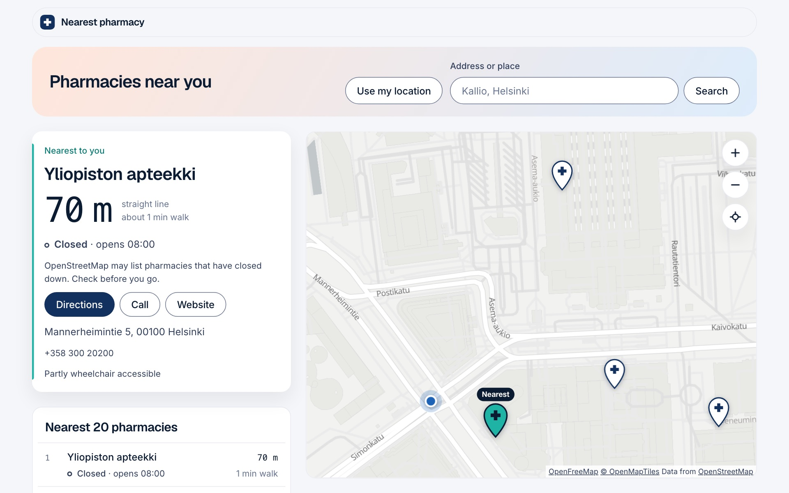
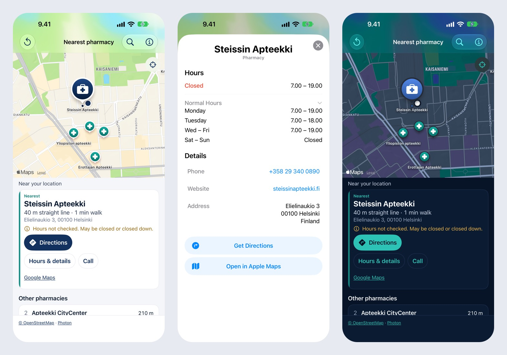

# Nearest pharmacy

Finds the pharmacy closest to you. Web app: **https://nearest-pharmacy.vercel.app**





- [`web/`](web/): the web app (Vite, React, TypeScript)
- [`ios/`](ios/): the iOS app (SwiftUI, MapKit)

```sh
cd web && npm ci && npm run dev     # http://localhost:5173, needs Node 22.12 or newer
open ios/NearestPharmacy.xcodeproj  # then run it in a simulator with iOS 18 or later
```

An independent demo. Not affiliated with any pharmacy or healthcare provider.
