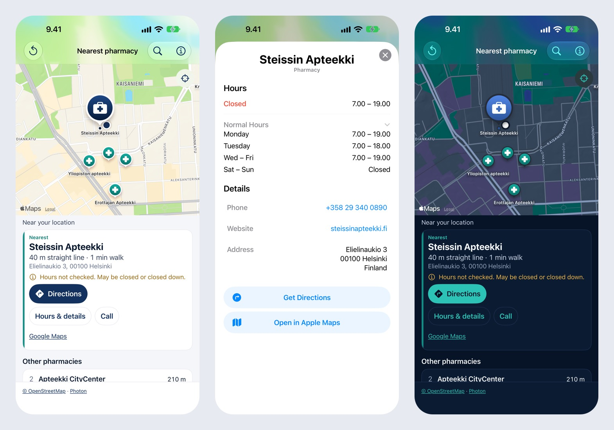

# Nearest pharmacy for iOS

A SwiftUI app that finds the pharmacy closest to you. It is an independent demo with no dependencies,
API keys or accounts.

## Run it

Open `NearestPharmacy.xcodeproj` in Xcode (developed with 27.2) and run it in a simulator with iOS 18 or
later. For a device, choose your own team under Signing & Capabilities.

To set a position in the simulator: Features › Location › Custom Location, for example Helsinki
Central (60.1719, 24.9414). Without one, the app says it couldn't find your location after about 12 seconds.

## How it works

1. **Where you are.** Location is requested only after you tap "Use my location". Without it, you can
   search for an address or place (Apple's search).
2. **Which pharmacies.** One request to [Photon](https://photon.komoot.io) returns up to 30 OpenStreetMap
   pharmacies within 100 km. It gets your position rounded to about 100 m. The app ranks the results on
   the phone, from your exact position.
3. **The nearest one.** The app looks it up in Apple Maps on its own, to show the walking time and a Call
   button. Apple's place is used only if the category, distance and name agree. Otherwise the app says it
   couldn't match it.
4. **Hours & details.** This button opens Apple's place card, with opening hours and phone when Apple has
   them.

### Why not MapKit's pharmacy search?

Because it returns places that aren't pharmacies. On 2026-11-24 I compared both sources at ten public
points, each with a 5 km radius. The nearest result of each (metres, rounded
down):

| Point | MapKit pharmacy category | OpenStreetMap (Photon) |
|---|---|---|
| Helsinki Central | Steissin Apteekki, 66 m | Steissin Apteekki, 42 m |
| Kallio, Helsinki | Camila Poteket, 426 m | Brahen Apteekki, 253 m |
| Vuosaari, Helsinki | Apteekki Kompassi, 132 m | Apteekki Kompassi, 64 m |
| Tapiola, Espoo | Tapiolan apteekki, 18 m | Tapiolan Apteekki, 44 m |
| Tampere | Yliopiston Apteekki, 130 m | Yliopiston Apteekki, 123 m |
| Rovaniemi | Sampo Apteekki, 193 m | Sampo Apteekki, 208 m |
| Nuuksio, Espoo | none | none (Veikkolan apteekki within 15 km) |
| Berlin Mitte | Nexus peptides science, 263 m | Apotheke Hackesches Quartier, 296 m |
| London | Dewshi Chemist, 56 m | Boots, 238 m |
| New York | Duane Reade, 72 m | Duane Reade, 79 m |

MapKit's results also included a vape shop in Helsinki and a supplement store in Rovaniemi.
OpenStreetMap isn't always better: it lacked London's Dewshi Chemist. And it can list a pharmacy that has
closed: Apple Maps marks Brahen Apteekki "Permanently Closed", and I could not find out which is right.

MapKit exposes no closure status or opening hours in code, so the app can't check either. The nearest
card says so, and offers Hours & details, Call and a Google Maps link (a search, no API key).

## Code

| Folder | Contents |
|---|---|
| `Domain/` | Value types, name matching, links, formatting |
| `Services/` | Photon, Core Location, Apple Maps |
| `Model/` | `AppModel`, the observable state the views bind to |
| `Views/` | SwiftUI screens |
| `Design/` | Colors, button styles, assets |

Three small protocols let the Xcode previews run on fakes. In Debug builds the launch argument
`-failPharmacySearch` (unticked in the scheme) makes the first search fail, to show the error screen.

## Limits

- Distances are straight lines. Only the nearest pharmacy gets a walking time: Apple's route, or an estimate
  at 5 km/h marked `~` when there is no route. Beyond 3 km the app shows none.
- Opening hours aren't checked.
- Photon is a free public service with no uptime promise and no second source here. If it fails, the app
  says so and offers Try again and Apple Maps. It never reports "no pharmacies" for a failed request.
- OpenStreetMap and Apple Maps can be out of date, and OpenStreetMap lists some places that only hand out
  orders as pharmacies.
- Your rounded position is sent to Photon. Apple gets the places you search for, your position for the
  walking time, and the name of the nearest pharmacy and of any other you open details for. The Google
  Maps link sends that pharmacy's name and address, or its position, to Google.
- English only.

## Next

Show opening hours for the nearest pharmacies (OpenStreetMap has them, and the web app evaluates them),
add Finnish and Swedish, and add a second source for when Photon is down.
